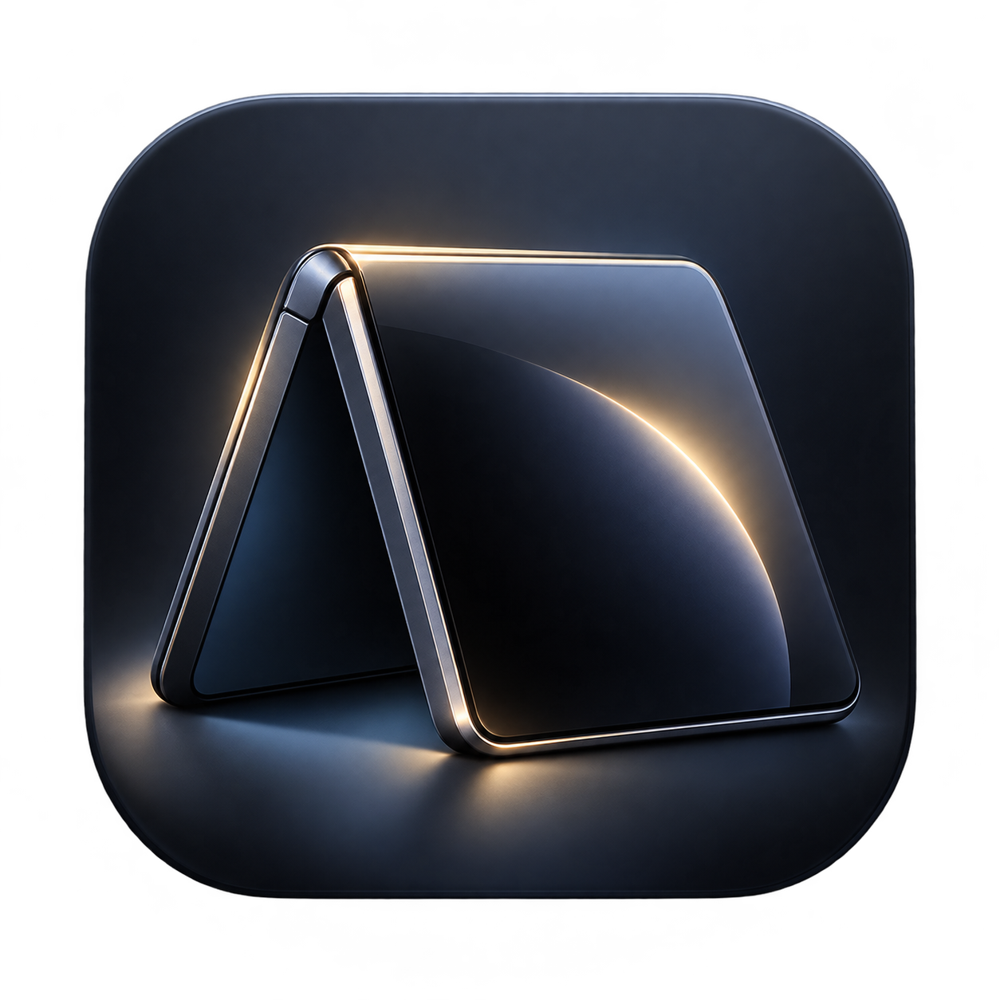

  

# F8scape

**A quiet, dark StandBy display built specifically for the Samsung Galaxy Z Fold 8.**  
*(Pronounced “Fatescape”)*

Prop your Galaxy Z Fold 8 on a desk, nightstand, or bedside table in **tent mode**, and F8scape turns the outer cover screen into a clean, ambient glanceable display. When you pick the phone up and turn it back upright to portrait mode, fold it closed, or unfold it flat, it smoothly gets out of your way.

No accounts. No subscriptions. No ads or tracking. Just a fast, native utility designed around the Fold 8's cover display.

---

## ✨ What It Can Do

### 1. Automatic Tent Mode & Instant Portrait Exit
- **Hands-Free Activation:** Detects when your Fold 8 is propped in tent mode and smoothly fades into StandBy without having to unlock the phone first.
- **Smart Motion Tolerance:** Resting on a mattress, sofa arm, or soft nightstand won't accidentally kill the screen—it stays comfortably on while propped horizontally.
- **Instant Portrait Exit:** As soon as you lift the phone and turn it upright into portrait mode (or fold it flat/closed), it dismisses promptly so your normal phone interface is ready right away.

### 2. Ambient Dashboard & Full-Screen Views
Swipe easily between views with fluid physical glide transitions. When left untouched, controls auto-fade for a clean, distraction-free bedside experience:
- **Split Dashboard:** A balanced everyday desk view. Shows your chosen clock on the left alongside a smart card on the right (seamlessly switching to your music player when audio is playing, or your calendar, weather, and battery metrics).
- **Full-Screen Clock:** A large, room-legible timepiece supporting both 12-hour and 24-hour formats across **6 styles**:
  - *Default* — Modern balanced typography
  - *Fluid Gradient* — Soft multi-tone gradient numerals
  - *Split Flip* — Classic mechanical flip clock
  - *Neon Outline* — Clean geometric stencil glow
  - *Analog Chrono* — Watch dial with sweeping hands
  - *Retro LED* — 7-segment digital matrix with hardware AM/PM indicators
- **Full-Screen Calendar:** Full-month schedule with 5 distinct layouts (*Default*, *Agenda Split*, *Minimal Dot*, *Editorial Bold*, and *Bento Boxed*) and single-day event timelines.
- **Full-Screen Media Player:** Displays currently playing music or podcasts with full album art, an animated progress scrubber, large playback controls, and a **top-edge swipe gesture** to adjust volume smoothly.
- **Full-Screen Weather Intelligence:** An optional dedicated weather page showing live temperatures, weather conditions, rain forecast, wind, humidity, and upcoming daylight metrics for your city.

### 3. Interactive Notification Cards & Status Silhouettes
- **Status Silhouettes:** Subtle monochrome icons appear right above your clock on the dashboard, giving you a quiet hint of unread notifications from messaging and email apps without noisy popups or intrusive banners.
- **Interactive Notification Deck:** Tap the notification icons to smoothly glide open an interactive notification view, pairing the time on the left with clean notification cards on the right. Tap a card to jump straight into the app. *(Optional in Settings)*.

### 4. Ambient Photo Frame
Transform your Galaxy Z Fold 8 into a dedicated digital photo frame when propped horizontally:
- **Zero Broad Storage Permissions:** Uses Android’s official system Photo Picker and Storage Access Framework (SAF) to pick specific photos or choose a dedicated folder. F8scape never requests broad media access and never scans or uploads your private photos.
- **Smooth Slideshow:** Seamless 900ms crossfade transitions between photos, customizable intervals (30s, 1m, 2m, 5m, 15m), and a smart shuffle mode that avoids repeating photos back-to-back.
- **Customizable Overlays:** Choose clean **Immersive** photos, or overlay an ambient **Clock** or **Calendar** in any corner (Top-Left, Top-Right, Bottom-Left, or Bottom-Right).
- **Lock-Screen Privacy Shield:** By default, personal photos are shielded with a calm ambient gradient when your device is locked, keeping your private memories secure.
- **Subtle Motion & Battery Care:** Optional gentle Ken Burns zoom and pan that pauses automatically when settled or in Eco/Battery Saver mode.

### 5. Quick Settings Tile
- Add the **F8scape StandBy** tile directly to your Samsung Quick Settings panel (swipe down twice from the top of your screen, tap edit, and drag the F8scape tile into your active buttons).
- Tap the tile anytime to instantly pause automatic StandBy activation or manually launch the display.

### 6. Touch-and-Hold Live Studios & Edge Gestures
- **Long-press the Clock** to open the **Clock Studio** and customize styles, accent colors, and choose between subtle `Highlights` or bold `Full Colour`.
- **Long-press the Calendar** to open the **Calendar Studio** and customize layouts, highlights, and accent colors.
- **Swipe up/down along the left screen edge** on any StandBy view to adjust screen brightness on the fly.

### 7. OLED Longevity & Battery Care
- **Burn-In Protection:** Subtle pixel-shifting prevents static pixel fatigue during overnight docking.
- **Eco Mode:** Automatically drops to pure black OLED pixels with reduced sensor polling when Battery Saver is active.
- **Auto-Off Timer:** Option to turn the display off after 15, 30, or 60 minutes, or stay on continuously while docked.
- **Call Protection:** Automatically hides the StandBy screen the moment a phone call rings or connects.

---

## 🔐 Permissions & Why We Need Them

We believe in complete transparency. F8scape only requests permissions that directly power user-facing features, and your private data never leaves your device:

| Permission | Why F8scape Uses It | Plain English Privacy Guarantee |
| :--- | :--- | :--- |
| **Accessibility Service** *(Required)* | Allows Android to detect when the phone is propped in tent mode and show the StandBy display over the cover screen without having to unlock the phone first. | F8scape cannot see your passwords, text you type, or content from other apps. It is strictly used to monitor hinge posture and host the ambient display. |
| **Appear on Top** *(Required)* | Lets F8scape draw the dark StandBy screen on top of your cover display when tented. | Used purely to render the visual StandBy screen. |
| **Photo Access** *(Zero Extra Permissions)* | Uses Android’s official system Photo Picker and Storage Access Framework. | You select only the exact photos or folder you want to display. F8scape never requests broad media/file access and never uploads any images. |
| **Notification Access** *(Optional)* | Detects active media playback (Spotify, YouTube Music, Apple Music, podcasts, etc.) to show album art and controls, and displays subtle status bar notification silhouette icons. | Personal notification text and messages are never read, stored, or sent anywhere. |
| **Calendar** *(Optional)* | Displays event dots and your next upcoming appointments on the calendar card. | Read locally on-device. Your calendar schedule never leaves your phone. |
| **Wallpaper / Media** *(Optional)* | Extracts your current home wallpaper so it can be shown as a subtle, ambient background behind the clock. | Used only to display your background locally. |
| **Internet** *(Optional)* | Fetches local weather updates from Open-Meteo and checks GitHub for new app releases. | Outbound requests are strictly limited to weather forecasts and GitHub release checks over secure HTTPS. |
| **Install Updates** *(Optional)* | Allows you to download and install new F8scape releases directly from within the app. | Uses Android’s standard package installer prompt; only installs official signed F8scape updates. |

---

## 📦 Download & Installation

1. Grab the latest release APK (`F8scape-v1.1.0.apk`) from the [**Releases**](../../releases) page on your Galaxy Z Fold 8.
2. Tap the APK to install it.
3. Open **F8scape** and follow the quick 2-step setup (**Accessibility Service** and **Appear on Top**).
4. Select your preferred StandBy preset (**Dashboard**, **Minimal**, **Media**, or **Photo Frame**) in Settings.
5. Prop your Fold 8 into **tent position** (`~90°`) on your desk or nightstand.

### Built-in In-App Updates
F8scape includes a built-in updater. It checks for new GitHub releases in the background, or you can tap **Check for Updates** anytime in Settings or About to install updates directly with one tap.

---

## 📄 License & Disclaimer

F8scape is an independent open-source utility designed specifically for Galaxy Z Fold 8 owners and is not affiliated with or endorsed by Samsung Electronics.
